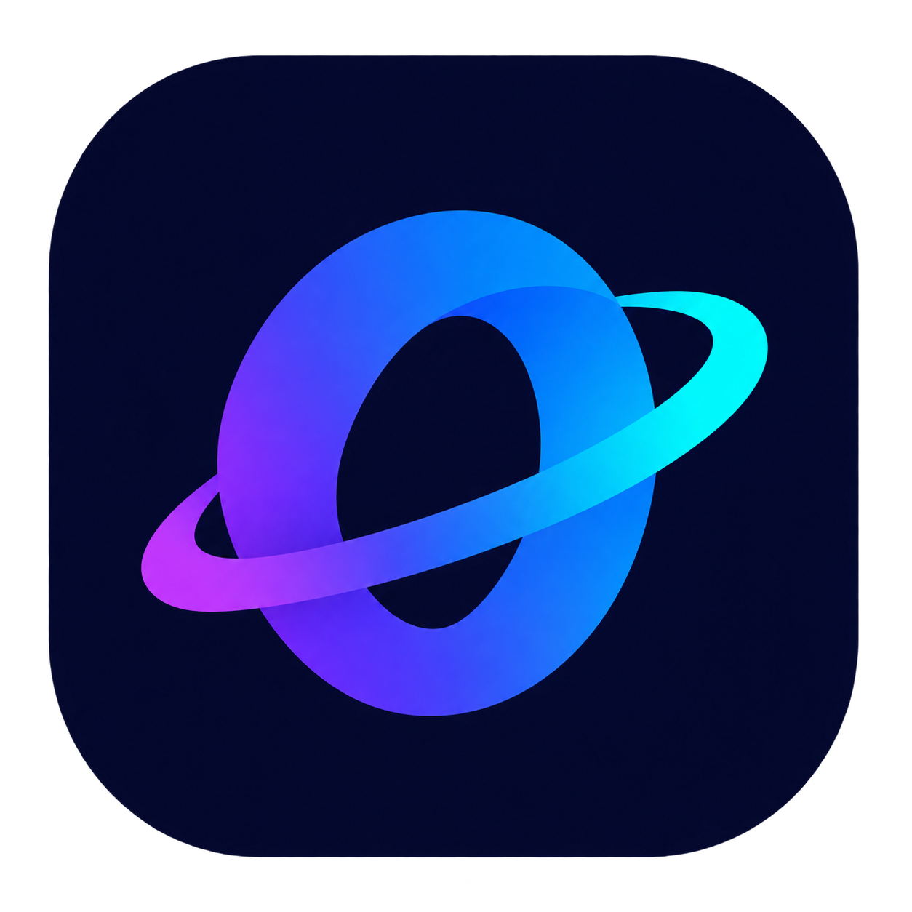

<p align="center">
  
</p>

<h1 align="center">Ovren</h1>

<p align="center">
  A calmer way to understand and manage your desktop.<br>
  Made by Licht · Version 1.3.5
</p>

<p align="center">
  <a href="https://github.com/lylicht/ovren/releases/latest">Download the latest release</a>
  ·
  <a href="https://github.com/lylicht/ovren/issues">Report an issue</a>
</p>

Ovren is a desktop toolkit for Windows, macOS, and Linux. It brings storage insights, careful cleanup tools, system controls, network utilities, and file browsing into one focused app.

## What you can do

- **Understand storage:** inspect disk usage, find large files and duplicates, and choose folders to scan.
- **Review before cleanup:** preview selected changes, then choose what to remove.
- **Manage your system:** work with startup items, installed apps, privacy cleanup, system maintenance, and operation history.
- **Browse files:** navigate folders, search file and folder names recursively, open items with their system app, and move the browser into its own resizable window.
- **Measure and manage networks:** run latency and speed checks, see which server handled a check, and configure OvrenNET adapter merging, traffic weights, speed limits, IPv6, MTU, and a loopback SOCKS5 proxy.
- **Tune pointer controls:** adjust mouse speed and acceleration on supported Windows and GNOME systems.

Ovren uses a macOS-inspired interface and [SFStudio icons](https://github.com/lylicht/SFStudio), with light and dark themes.

## Download

Download installers from [GitHub Releases](https://github.com/lylicht/ovren/releases/latest).

| System  | Package                             |
| ------- | ----------------------------------- |
| Windows | NSIS installer                      |
| macOS   | Disk image (`.dmg`)                 |
| Linux   | AppImage or Debian package (`.deb`) |

Ovren checks the signed update feed hosted by this repository's GitHub Releases.

**First launch:** Windows may show an untrusted-publisher warning because the installer uses a self-signed certificate. The macOS app is not notarized yet, so macOS may ask you to approve it the first time you open it.

## Build from source

You need Node.js 24 or later, pnpm 11.13.1, Rust 1.99 or later, and the native Tauri prerequisites for your operating system.

```sh
cd app
corepack pnpm install --frozen-lockfile
corepack pnpm tauri:dev
```

Build an installer with the command for your platform:

```sh
corepack pnpm tauri:build
corepack pnpm tauri:build:linux
corepack pnpm tauri:build:mac
```

Run the project checks with `corepack pnpm check` from `app/`.

## Privacy

File browsing and name searches run locally. Recursive search covers the open folder and does not follow directory symlinks. Network speed checks use Cloudflare, transfer about 16 MB per run, and expose your public IP address to Cloudflare.

## License

Ovren is distributed under [GPL-3.0-only](LICENSE). Third-party license information is available in the app's Third-Party Licenses screen.
